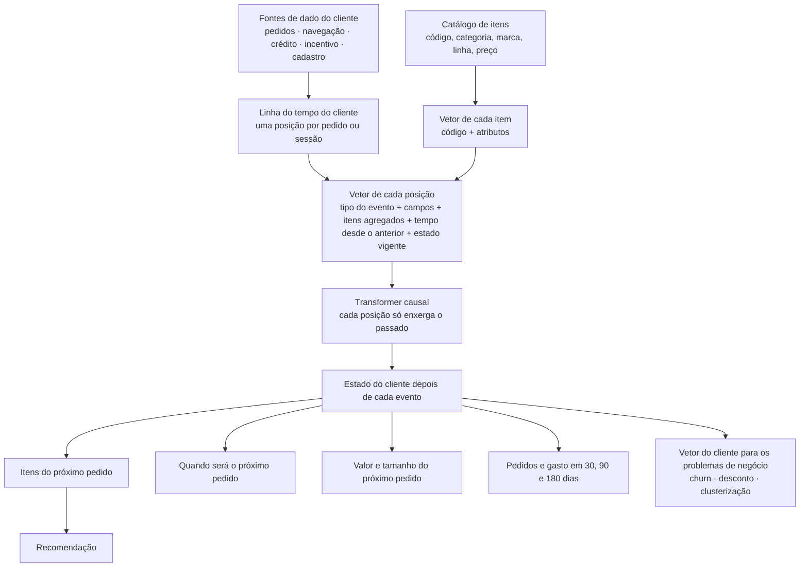

# Motor v2 — evento composto

Desenho detalhado do motor v2, escrito antes da primeira execução, como pede
`PLANO_FASE3.md` (etapa 2). Registra o que muda em relação ao motor atual
(v1), o formato dos dados, o modelo, o que ele aprende a prever e como é
testado. As hipóteses que ele precisa atender são a F3-H3, F3-H4, F3-H5 e
F3-H6, com os critérios do plano.

## 1. Por que mudar

| Problema medido no v1 | Evidência | Resposta no v2 |
|---|---|---|
| Cada item vira cerca de 11 tokens; a janela de 1.024 tokens guarda uns 93 itens | Um pedido com centenas de itens não cabe; um cliente com milhares de pedidos perde quase todo o histórico | Uma posição por pedido (ou sessão), não por campo |
| A identidade do produto se perde | Só 2.000 artigos têm token próprio (27% das vendas); 90% das compras da semana de teste caem em "outros" | Todo item do catálogo tem vetor próprio, feito do seu código e dos seus atributos |
| O modelo aprende o calendário | Os segmentos do embedding explicam 57% a 71% do mês da compra (F3-H2) | O tempo entra como informação de entrada e deixa de ser algo a prever |
| O pré-treino não aponta para as perguntas de negócio | 80% da loss é prever atributos do próximo item | O modelo prevê o próximo pedido e o que acontece nos 30, 90 e 180 dias seguintes |
| Só existe um tipo de evento | A H&M só tem compras; a empresa tem navegação, crédito e incentivo | Cada fonte de dado é um tipo de evento na mesma linha do tempo |

## 2. Visão geral

No v1, a sequência do cliente é uma fila de tokens, um por campo de cada item.
No v2, a sequência é uma fila de **eventos**: cada posição é um pedido inteiro,
uma sessão de navegação ou outro evento, já resumido num único vetor.

## 3. Dados de entrada

### 3.1 Fontes

O YAML passa a declarar uma lista de fontes. Cada fonte tem uma natureza:

| Natureza | O que é | Exemplo | Como entra na linha do tempo |
|---|---|---|---|
| `itens` | Evento formado por várias linhas | Pedido e seus itens; cesta do dia na H&M | Uma posição por grupo de linhas |
| `evento` | Evento simples, de alta frequência | Busca, visualização, carrinho | Uma posição por sessão (eventos a menos de 30 min um do outro) |
| `estado` | Valor que vale até mudar | Limite de crédito, nível no programa de incentivo | Não ocupa posição: o valor vigente é anexado a cada posição |
| `estatico` | Atributo fixo do cliente | Tipo de cliente, região | Fica fora da sequência; entra nas cabeças, como hoje |

Um config do v1 continua valendo: ele é lido como uma única fonte de natureza
`itens`, agrupada por cliente e dia.

### 3.2 Catálogo

O catálogo declara o campo que identifica o item e os atributos dele. O vetor
de um item é a soma de duas partes:

- um vetor próprio do código do item, para todo item visto no treino;
- os vetores dos atributos (categoria, marca, linha, faixa de preço).

Um item novo ou raro é representado só pelos atributos. Durante o treino, o
vetor próprio é desligado ao acaso em 10% das vezes, para o modelo aprender a
usar os atributos.

### 3.3 Vetor de uma posição

O vetor de uma posição soma:

1. o tipo do evento (pedido, sessão de navegação, …);
2. os campos do cabeçalho (canal, forma de pagamento);
3. as linhas do evento, agregadas: média dos vetores das linhas e uma faixa
   para o número de linhas. O vetor de uma linha é o vetor do item mais os
   campos numéricos da linha em faixas (quantidade, preço relativo, desconto);
4. o tempo: intervalo desde a posição anterior, em faixas, e o calendário da
   data (mês e dia da semana), só como entrada;
5. o estado vigente de cada fonte de natureza `estado`.

Os campos numéricos usam as faixas de quantil que o motor já calcula, só com
dados de treino.

### 3.4 Janela

O modelo vê as últimas 512 posições de cada cliente. Na H&M isso cobre o
histórico inteiro de todos os clientes (o máximo é 427 cestas). Para quem tem
mais posições que isso, o histórico mais antigo entra só pelos agregados do
braço híbrido. No treino, históricos longos são divididos em janelas.

## 4. O que o modelo aprende a prever

Em cada posição, o estado do cliente é usado para prever o que vem depois.
Todos os alvos se referem ao **próximo pedido** depois daquela posição, mesmo
que haja sessões de navegação no meio.

| Alvo | Forma | Para que serve |
|---|---|---|
| Itens do próximo pedido | Probabilidade sobre o catálogo inteiro; cada item do próximo pedido é um acerto | Recomendação |
| Intervalo até o próximo pedido | 16 faixas de dias | Churn e recência |
| Valor e número de linhas do próximo pedido | Faixas | Valor do cliente |
| Pedidos e gasto em 30, 90 e 180 dias | Faixas | Churn, LTV e propensão em geral |

Ficam **fora dos alvos**, de propósito, o canal do próximo pedido e o uso de
desconto. Eles entram como informação de entrada, mas o modelo nunca é
treinado para prevê-los. São as perguntas de teste da F3-H5: medem se o vetor
serve a uma pergunta que ele nunca viu.

### 4.1 Regra de censura

É a mesma lição do defeito achado no rótulo de churn em 14/11. O treino tem
uma data de corte. Para cada posição:

- **Próximo pedido não observado até o corte.** Os alvos de itens, valor e
  linhas são ignorados. O alvo de intervalo não é ignorado: a posição entra
  dizendo ao modelo que o intervalo é **maior** que o tempo entre ela e o
  corte. Assim quem não voltou também conta, e não só quem voltou.
- **Janela de 30, 90 ou 180 dias que passa do corte.** O alvo dessa janela é
  ignorado, tenha ou não havido pedido dentro dela.

Nenhum alvo usa informação posterior à data de corte.

## 5. Modelo

- **Blocos.** Os mesmos do backbone final do v1: RoPE, SwiGLU e atenção
  agrupada, com 256 dimensões e 6 camadas. A atenção é causal.
- **Entrada.** Um módulo novo monta o vetor de cada posição (seção 3.3). As
  linhas de todos os eventos do lote ficam num único tensor, com o índice da
  posição a que pertencem; a agregação é uma soma indexada. Um pedido de 800
  linhas custa 800 vetores de linha e uma posição.
- **Saída de itens.** O estado é projetado e comparado com o vetor de cada
  item do catálogo, os mesmos vetores usados na entrada. Com até cerca de 100
  mil itens, a probabilidade é calculada sobre o catálogo inteiro. Acima
  disso, por amostragem (fora do escopo da etapa 2).
- **Demais saídas.** Uma camada linear por alvo.
- **Perda.** Soma das perdas dos alvos, cada uma dividida pelo logaritmo do
  número de classes, para nenhuma dominar pela escala.

## 6. Como o v2 serve aos 4 problemas

| Problema | O que sai do modelo | Cabeça leve |
|---|---|---|
| Recomendação | As probabilidades de item na última posição antes do período-alvo | Nenhuma: os 12 itens mais prováveis |
| Churn em 90 dias | O vetor do cliente na âncora | Linear ou DCNv2 pequena |
| Propensão a desconto | O vetor do cliente na âncora | Linear ou DCNv2 pequena |
| Clusterização | O vetor do cliente na âncora (e a média dos vetores da janela, como alternativa escolhida na validação) | K-means |

As âncoras, os rótulos, os splits e os scripts de fusão, de GBDT e de
avaliação são os mesmos do v1. O v2 grava os vetores no mesmo formato
(`embeddings_eventos.npy` e o índice), então a comparação é direta.

## 7. Arquivos

| Arquivo | Papel |
|---|---|
| `pipeline/common/v2_esquema.py` | Lê as fontes e o catálogo do YAML; converte um config do v1 |
| `pipeline/common/v2_serializacao.py` | Monta as posições, as linhas, os alvos e as máscaras de censura |
| `pipeline/common/v2_modelo.py` | Módulo de entrada, blocos do decoder e saídas |
| `pipeline/common/v2_pretreino.py` | Treino com checkpoint e retomada |
| `pipeline/common/v2_extrair.py` | Vetores nas âncoras e pontuação de itens |
| `pipeline/common/v2_testes.py` | Testes da seção 8 |

## 8. Testes antes de qualquer resultado

1. **Causalidade.** Alterar eventos futuros não muda o estado das posições
   anteriores.
2. **Censura.** Num exemplo construído à mão, nenhum alvo usa evento
   posterior ao corte, e a posição sem próximo pedido entra só no alvo de
   intervalo.
3. **Aprendizado mínimo.** Num lote pequeno repetido, a perda de cada alvo cai
   para perto de zero.
4. **Estrutura plantada.** Na base sintética de beleza (tamanho mini), a
   recomendação do modelo recupera itens de reposição e de compra conjunta
   acima do acaso.
5. **Portabilidade.** As bases sintética agro e Olist rodam no v2 com o config
   do v1.

## 9. Ordem de implementação

1. Serialização e testes de censura, na base sintética de beleza (mini) e na H&M.
2. Modelo e pré-treino; testes 1, 3 e 4 na CPU local.
3. Extração dos vetores e F3-H3 na H&M (Colab).
4. Saída de itens com o backbone treinado até a véspera da semana-alvo: F3-H4.
5. Alvos de janela futura e perguntas de fora dos alvos: F3-H5.
6. Bateria completa em dois cortes temporais: F3-H6.

## 10. Riscos

- **Recomendação contra uma régua forte.** O ranqueador tradicional da F2-H3
  usa candidatos e features feitos à mão. O modelo direto pode ficar entre a
  heurística simples e a régua; o plano já prevê esse caso.
- **Vetor do cliente ainda preso ao último evento.** A média dos vetores da
  janela é a alternativa prevista; um objetivo contrastivo por cliente fica
  como reserva.
- **Custo da saída de itens.** Calcular a probabilidade sobre 100 mil itens em
  cada posição é a parte mais cara do treino. O tempo por época é medido na
  F3-H3, contra o do v1.
